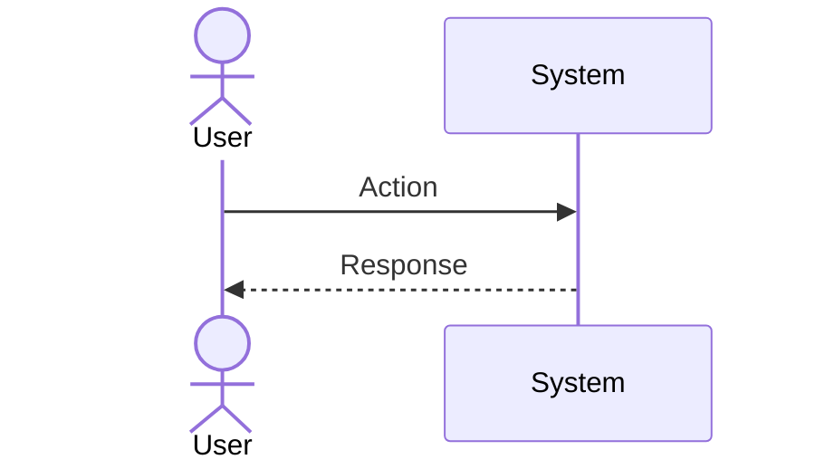
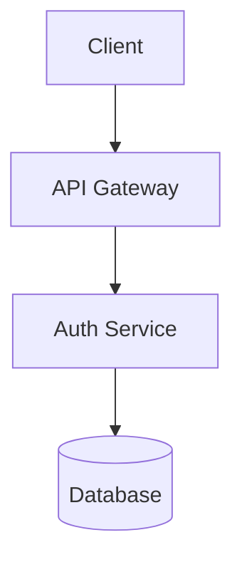

# Spec RFC Methodology
## A Formal Specification Authoring Standard for Software Systems
### Synthesizing IETF RFC, EARS, and Kiro Spec Conventions

> **Document Status**: Living Standard  
> **Category**: Best Current Practice  
> **Source Research**: firecrawl-scraped from alistairmavin.com/ears, rfc-editor.org/rfc/rfc7230, rfc-editor.org/rfc/rfc2119, rfc-editor.org/rfc/rfc7322, Wikipedia EARS article (2026-03-11 revision)  
> **Last Updated**: 2026-09-14

---

## Table of Contents

```
1.  Introduction
    1.1. Purpose and Scope
    1.2. Requirements Notation (RFC 2119 Keywords)
    1.3. Definitions and Abbreviations

2.  Document Structure
    2.1. Front Matter
    2.2. Abstract
    2.3. Status of This Memo
    2.4. Table of Contents
    2.5. Body Sections (ordered)
    2.6. IANA Considerations
    2.7. Security Considerations
    2.8. Normative References
    2.9. Informative References
    2.10. Appendices

3.  EARS Requirements Methodology
    3.1. Background and Origins
    3.2. Generic EARS Syntax (BNF)
    3.3. The Five EARS Patterns
         3.3.1. Ubiquitous
         3.3.2. State-Driven (While)
         3.3.3. Event-Driven (When)
         3.3.4. Optional Feature (Where)
         3.3.5. Unwanted Behaviour (If-Then)
    3.4. Complex Requirements (Pattern Composition)
    3.5. EARS Ruleset and Constraints
    3.6. Anti-Patterns and Common Errors
    3.7. EARS vs. Other Methods (Comparison Table)

4.  Combining RFC Structure with EARS
    4.1. Mapping EARS Patterns to RFC Requirement Levels
    4.2. Traceability Identifiers (REQ-NNN)
    4.3. ABNF Grammar for Formal Constraints
    4.4. Worked Example: Spec for an Authentication System

5.  Applying This to sdd / Kiro Specs
    5.1. requirements.md Template
    5.2. design.md Template
    5.3. tasks.md Template

6.  Normative References
7.  Informative References
```

---

## 1. Introduction

### 1.1. Purpose and Scope

This document defines a unified methodology for writing **formal software specifications** that combines:

- **IETF RFC conventions** (RFC 7322 Style Guide, RFC 2119 key words) — for unambiguous normative language and document structure
- **EARS notation** (Easy Approach to Requirements Syntax, Mavin et al., 2009–2019) — for structured, machine-parseable natural language requirements
- **Kiro Spec conventions** (`.kiro/specs/` format, Amazon, 2025) — for agentic, spec-driven development workflows

The output of applying this methodology is a specification document that is:

1. **Human-readable** — using constrained natural language, not formal mathematics
2. **Machine-parseable** — structured enough that an AI coding agent can extract requirements, validate them, and generate tasks without ambiguity
3. **Auditable** — with stable identifiers, traceability links, and a version history
4. **Interoperable** — tool-agnostic and compatible with Cursor, Claude Code, GitHub Copilot, and any agent that reads Markdown

This document uses RFC 2119 key words to define the normative requirements of the methodology itself.

### 1.2. Requirements Notation (RFC 2119 Keywords)

The following key words from **RFC 2119** (Bradner, 1997) are used throughout this document and MUST be treated as normative:

| Keyword | Meaning |
|:---|:---|
| **MUST** / **REQUIRED** / **SHALL** | Absolute requirement |
| **MUST NOT** / **SHALL NOT** | Absolute prohibition |
| **SHOULD** / **RECOMMENDED** | Strong recommendation; deviation requires justification |
| **SHOULD NOT** / **NOT RECOMMENDED** | Strong discouragement; deviation requires justification |
| **MAY** / **OPTIONAL** | Truly optional behavior |

> **Critical Usage Guidance (RFC 2119 §6):** These imperatives MUST only be used where interoperability or safety actually require it. Overuse of MUST degrades the signal-to-noise ratio of a specification. Use SHOULD for conventions; reserve MUST for behavioral boundaries.

### 1.3. Definitions and Abbreviations

| Term | Definition |
|:---|:---|
| **EARS** | Easy Approach to Requirements Syntax |
| **IETF** | Internet Engineering Task Force |
| **RFC** | Request for Comments — the IETF's formal publication series |
| **BNF / ABNF** | (Augmented) Backus-Naur Form — formal syntax notation (RFC 5234) |
| **Precondition** | A state that must hold before a requirement applies (EARS: `While`) |
| **Trigger** | A discrete event that activates a requirement (EARS: `When`) |
| **System Response** | The observable behavior the system SHALL exhibit |
| **REQ-NNN** | A stable numeric identifier for a single EARS requirement |
| **Normative** | Text that defines conformance criteria — implementors MUST follow |
| **Informative** | Explanatory text that does not impose requirements |

---

## 2. Document Structure

### 2.1. Front Matter

Every spec document MUST begin with a YAML frontmatter block (following Google OKF v0.1 conventions):

```yaml
---
type: Specification
title: "<Short Descriptive Title>"
status: draft | active | superseded | deprecated
version: "1.0.0"
authors:
  - name: "<Author Name>"
    contact: "<email or handle>"
created: "YYYY-MM-DD"
updated: "YYYY-MM-DD"
spec-id: "<feature-slug>"
category: standards-track | informational | best-current-practice | experimental
tags: []
---
```

**Field rules:**
- `type`: MUST be `Specification`
- `status`: MUST be one of: `draft`, `active`, `superseded`, `deprecated`
- `version`: MUST follow `<major>.<minor>.<patch>` SemVer. A minor bump adds backward-compatible EARS patterns. A major bump may change required fields or patterns.
- `spec-id`: MUST be a lowercase kebab-case slug matching the parent directory name

### 2.2. Abstract

The Abstract MUST:
- Be 3–10 sentences long
- State **what** the system does (not how it is built)
- Identify the primary actors and the core problem being solved
- NOT contain normative language (no MUST/SHALL)
- NOT reference implementation details

### 2.3. Status of This Memo

This section SHOULD follow the standard RFC boilerplate pattern:

```
This document defines a [Standards Track | Informational | Best Current Practice |
Experimental] specification. It represents the agreed design of [system name] as
of [date]. Feedback and errata should be reported to [contact].
```

### 2.4. Table of Contents

Every spec document with more than 3 sections MUST include a nested Table of Contents with section numbers.

### 2.5. Body Sections (Ordered)

Standard section ordering for software specifications (adapted from RFC 7230):

```
1.  Introduction
    - Problem statement (no solution)
    - Scope: what is IN and OUT of scope
    - Guiding design principles

2.  Architecture / System Overview  
    - High-level Mermaid diagram (sequence or component)
    - Actor definitions
    - System boundaries

3.  Functional Requirements (EARS format — see §3)

4.  Non-Functional Requirements
    - Performance thresholds (measurable, e.g., "p99 latency SHALL be < 200ms")
    - Scalability constraints
    - Availability SLAs

5.  Interface Definitions
    - API contracts (method, path, request/response schemas)
    - Event schemas
    - Data model definitions

6.  Error Handling
    - Error taxonomy (REQ- references)
    - Retry and backoff policies
    - Degraded-mode behavior

7.  Security Considerations (REQUIRED by RFC 3552 convention)
    - Authentication and authorization model
    - Attack surface analysis
    - Data sensitivity classification

8.  IANA / Registry Considerations (if applicable)

9.  Open Questions and Deferred Decisions

10. Changelog / Version History
```

### 2.6. Security Considerations

Every specification MUST include a Security Considerations section, even if it states explicitly: *"This specification introduces no new security considerations beyond those of its dependencies."*

This requirement is derived from **RFC 3552** ("Guidelines for Writing RFC Text on Security Considerations").

### 2.7. Normative vs. Informative References

References MUST be split into two lists:

- **Normative**: References whose contents form part of the conformance criteria. An implementor MUST read and follow these.
- **Informative**: Background reading, related work, or context. An implementor MAY ignore these.

---

## 3. EARS Requirements Methodology

### 3.1. Background and Origins

EARS was developed by **Alistair Mavin** and colleagues at **Rolls-Royce PLC** while analyzing airworthiness regulations for jet engine control systems. The regulations contained high-level objectives, implicit requirements, lists, and supporting information — a common problem in any large system specification.

Mavin observed that requirements were easiest to read when clauses **always appeared in the same order**, following temporal logic. These patterns were refined and first published at the **IEEE International Requirements Engineering Conference (RE'09)** in 2009.

**Adoption milestones:**
| Year | Milestone |
|:---|:---|
| 2009 | Original EARS paper published at RE'09 |
| 2010 | "Big Ears" — extended experiments across multiple requirement sets (RE'10) |
| 2011 | "Easy EARS" — rapid application guide (RE'11, Industry Track) |
| 2016 | "Listens Learned" — 8 lessons from 7 years of industrial application (RE'16) |
| 2019 | "Ten Years of EARS" retrospective published in IEEE Software |
| 2025 | Amazon Kiro IDE adopts EARS for agentic spec-driven development |
| 2026 | EARS article added to Wikipedia; integrated into GitHub Spec Kit and sdd |

**Organizations using EARS:** Airbus, Bosch, Dyson, Honeywell, Intel, NASA, Rolls-Royce, Siemens.

### 3.2. Generic EARS Syntax (Formal BNF)

```abnf
ears-requirement    = [precondition ","] [trigger ","] system-clause
precondition        = "While" SP 1*(condition SP)
trigger             = "When" SP 1*(event SP)
                    / "If" SP 1*(condition SP) ", then"
                    / "Where" SP 1*(feature SP)
system-clause       = "the" SP system-name SP "shall" SP system-response
system-name         = 1*(ALPHA / SP / "-")
system-response     = 1*(ALPHA / SP / "," / ".")
condition           = 1*(ALPHA / SP / "-" / "\"")
event               = 1*(ALPHA / SP / "\"" / "-")
feature             = 1*(ALPHA / SP / "-")
```

**EARS Ruleset (from Mavin, 2009):**
A conformant EARS requirement MUST have:
- Zero or many preconditions (`While` clauses)
- Zero or one trigger (`When`, `If-Then`, or `Where` clause)
- Exactly one system name
- One or many system responses (conjoined with `and`)

### 3.3. The Five EARS Patterns

#### 3.3.1. Ubiquitous (No Keyword)

Always active. No precondition or trigger.

**Template:**
```
The <system name> shall <system response>.
```

**Example:**
```
REQ-001: The authentication service shall encrypt all passwords using bcrypt 
         with a cost factor of no less than 12.
```

**When to use:** Invariant constraints — properties that must hold in every possible system state, regardless of external conditions. Hardware limits, data format rules, security baselines.

---

#### 3.3.2. State-Driven (While)

Active as long as a specified state remains true.

**Template:**
```
While <precondition(s)>, the <system name> shall <system response>.
```

**Example:**
```
REQ-002: While the user session is unauthenticated, the API gateway shall 
         reject all requests to protected endpoints with HTTP 401.
```

**When to use:** Requirements that apply only during a particular operational phase — maintenance mode, offline mode, degraded state, high-load conditions.

---

#### 3.3.3. Event-Driven (When)

Specifies the system response to a discrete triggering event.

**Template:**
```
When <trigger>, the <system name> shall <system response>.
```

**Example:**
```
REQ-003: When a user submits valid login credentials, the authentication 
         service shall issue a signed JWT with an expiry of 15 minutes 
         and log the login event with a UTC timestamp.
```

**When to use:** Input-response pairs, state transitions triggered by user actions or external messages, webhook handlers, UI events.

---

#### 3.3.4. Optional Feature (Where)

Applies only in product variants or configurations that include a specified feature.

**Template:**
```
Where <feature is included>, the <system name> shall <system response>.
```

**Example:**
```
REQ-004: Where the enterprise SSO module is licensed, the authentication 
         service shall support SAML 2.0 identity provider federation.
```

**When to use:** Feature flags, licensed modules, hardware-dependent behavior, platform-specific constraints (e.g., iOS vs. Android), multi-tenant configuration variants.

---

#### 3.3.5. Unwanted Behaviour (If-Then)

Specifies the system's required response to undesired, exceptional, or failure conditions.

**Template:**
```
If <condition>, then the <system name> shall <system response>.
```

**Examples:**
```
REQ-005: If the database connection pool is exhausted, then the API 
         gateway shall return HTTP 503 with a Retry-After header of 30 seconds.

REQ-006: If a login attempt fails 5 consecutive times within 10 minutes, 
         then the authentication service shall lock the account and 
         send a notification email to the registered address.
```

**When to use:** Error handling, degraded-mode behavior, security responses to attacks, edge cases, timeout conditions, resource exhaustion.

---

#### 3.3.6. Complex Requirements (Pattern Composition)

Multiple EARS keywords MUST be used in the canonical clause order: `While → When → If-Then → system SHALL`. Combining keywords specifies requirements for richer, context-dependent behavior.

**Template:**
```
While <precondition(s)>, when <trigger>, the <system name> shall <response>.
While <precondition(s)>, if <condition>, then the <system name> shall <response>.
```

**Example (aerospace origin — from Mavin's original paper):**
```
REQ-007: While the aircraft is on the ground, when reverse thrust is 
         commanded, the engine control system shall enable reverse thrust 
         and record the activation event in the flight data recorder.

REQ-008: While the system is in maintenance mode, if an operator attempts 
         to deploy a new release, then the deployment pipeline shall 
         reject the deployment and display a maintenance lock warning.
```

**When to use:** State-conditional event handlers — requirements where a trigger only matters in a specific state, or where failure in a specific state requires a different recovery path.

### 3.4. EARS Ruleset and Constraints (Full)

| Rule | Constraint |
|:---|:---|
| **R1: Clause Order** | Preconditions MUST precede triggers. Triggers MUST precede the system clause. |
| **R2: One System** | Each requirement MUST name exactly one system. For multi-system interactions, write separate requirements with cross-references. |
| **R3: Atomic Response** | Each requirement SHOULD express one observable behavior. Use `and` to list concurrent responses; avoid `or` (creates ambiguity). |
| **R4: No Ambiguous Pronouns** | Do not use "it", "they", "this" — always repeat the subject noun. |
| **R5: No Escape Clauses** | Avoid "where possible", "as appropriate", "if necessary". These are not requirements — they are guidelines. Use SHOULD in the system response instead. |
| **R6: Measurable Responses** | Non-functional requirements MUST include a measurable threshold: not "the system shall respond quickly" but "the system SHALL respond within 200ms at the 99th percentile under a load of 1,000 concurrent users". |
| **R7: Stable IDs** | Each requirement MUST carry a stable `REQ-NNN` identifier. IDs are never reused or renumbered, even if a requirement is deleted (mark as `DELETED` or `SUPERSEDED BY REQ-NNN`). |

### 3.5. Anti-Patterns and Common Errors

| Anti-Pattern | Example | Fix |
|:---|:---|:---|
| **Escape clause** | "...shall handle errors appropriately" | Specify exact behavior: "shall return HTTP 500 and log the stack trace" |
| **Passive system** | "Data shall be validated" | Name the actor: "The validation service shall..." |
| **Conjunction ambiguity** | "...shall validate and store the input or reject it" | Split into two REQs: one for valid input, one for invalid |
| **Unmeasurable NFR** | "...shall be highly available" | "...SHALL maintain 99.9% uptime measured over a rolling 30-day window" |
| **Implicit precondition** | "When the user logs in, the system shall..." | Clarify whether this applies in all states or only while online |
| **Double modal** | "...should be able to support..." | Pick one: MUST support, or MAY support |
| **Hidden requirement** | Rationale text that says "the system stores this as JSON" | Move to a formal REQ or to the design section |

### 3.6. EARS vs. Other Methods (Comparison Table)

| Method | Format | Primary Use | Key Difference from EARS |
|:---|:---|:---|:---|
| **EARS** | Constrained NL with keywords | System/software requirements | Lightweight keyword-based patterns; no tool required |
| **Use Cases (UML)** | Structured prose + diagrams | Actor-goal analysis | Actor-centric; weaker for constraints and NFRs |
| **User Stories** | "As a [role], I want [goal]..." | Agile product backlog | Goal-oriented; lacks system response precision |
| **Formal Methods (Z, TLA+)** | Mathematical notation | Safety-critical systems | Machine-verifiable; high training overhead |
| **SysML Requirements** | Diagrams + tables | Model-based systems engineering | Tool-dependent; heavyweight; requires MBSE expertise |
| **IEEE 830 SRS** | Free-form structured document | Traditional project deliverable | No constrained syntax; highly variable quality |

---

## 4. Combining RFC Structure with EARS

### 4.1. Mapping EARS Patterns to RFC Requirement Levels

EARS patterns and RFC 2119 keywords operate at different layers: EARS constrains **the structure of the sentence**, while RFC 2119 keywords constrain **the strength of the obligation**. They MUST be used together:

| EARS Pattern | Natural RFC Level | Example Combination |
|:---|:---|:---|
| Ubiquitous | MUST / SHALL | "The system SHALL encrypt all tokens" |
| State-Driven | MUST / SHALL | "While offline, the system SHALL queue writes" |
| Event-Driven | MUST / SHALL | "When a request arrives, the gateway SHALL authenticate it" |
| Optional Feature | MAY / OPTIONAL | "Where SSO is enabled, the system MAY skip password prompts" |
| Unwanted Behaviour | MUST / SHALL | "If auth fails, the system SHALL return 401" |
| Recommendations | SHOULD / RECOMMENDED | "The system SHOULD use connection pooling" |

### 4.2. Traceability Identifiers (REQ-NNN)

Every EARS requirement MUST carry a stable identifier conforming to:

```
REQ-<domain>-<sequential-number>
```

Example identifiers:
- `REQ-AUTH-001` — first requirement in the authentication domain
- `REQ-API-023` — 23rd requirement in the API domain
- `REQ-PERF-005` — 5th performance requirement

**Traceability rules:**
- Tasks in `tasks.md` MUST reference their parent REQ: `_Implements: REQ-AUTH-001, REQ-AUTH-002_`
- Design decisions in `design.md` MUST note which REQs they satisfy: `_Satisfies: REQ-PERF-005_`
- When a requirement is changed, the old ID is marked `SUPERSEDED BY REQ-AUTH-042` and a new ID is minted — IDs are never reused

### 4.3. ABNF Grammar for Formal Constraints

For any protocol-level or data-format constraint, the specification SHOULD include an ABNF grammar (RFC 5234) alongside the EARS requirement:

```abnf
; REQ-API-007: Token format
jwt-token = header "." payload "." signature
header    = base64url
payload   = base64url
signature = base64url
base64url = *( ALPHA / DIGIT / "-" / "_" )
```

### 4.4. Worked Example: Spec for an Authentication System

```markdown
## 3. Functional Requirements

### 3.1. Authentication Domain

REQ-AUTH-001: The authentication service shall accept credentials only over 
              TLS 1.2 or higher.

REQ-AUTH-002: When a user submits a valid username and password, the 
              authentication service shall issue a signed JWT token 
              with an expiry of 15 minutes and a refresh token with 
              an expiry of 7 days.

REQ-AUTH-003: While a user session is active, the authentication service 
              shall validate the JWT signature on every protected API request.

REQ-AUTH-004: If a JWT token is expired, then the authentication service 
              shall return HTTP 401 with the body `{"error": "token_expired"}` 
              and include a `WWW-Authenticate: Bearer realm="api"` header.

REQ-AUTH-005: If login fails 5 consecutive times within 10 minutes, then 
              the authentication service shall lock the account for 15 minutes 
              and send a lockout notification to the registered email address.

REQ-AUTH-006: Where the multi-factor authentication feature is enabled for 
              an account, the authentication service shall require a valid 
              TOTP code after successful password verification before issuing 
              a token.

### 3.2. Non-Functional Requirements

REQ-PERF-001: The authentication service shall complete token issuance 
              within 300 milliseconds at the 99th percentile under a 
              sustained load of 500 concurrent authentication requests.

REQ-PERF-002: While the authentication service is operational, it shall 
              maintain availability of 99.9% measured over a rolling 
              30-day window.
```

---

## 5. Applying This to sdd / Kiro Specs

### 5.1. requirements.md Template

```markdown
---
type: Specification
title: "<Feature Name>"
status: draft
version: "1.0.0"
spec-id: "<feature-slug>"
authors:
  - name: "<Author>"
created: "YYYY-MM-DD"
updated: "YYYY-MM-DD"
---

# Requirements: <Feature Name>

## 1. Introduction

### 1.1. Problem Statement
<!-- What problem is being solved? What user pain or system gap does this address? -->

### 1.2. Scope
**In scope:**
- ...

**Out of scope:**
- ...

### 1.3. Guiding Principles
<!-- 2-5 design decisions that constrain the solution space. -->

---

## 2. Actors and System Boundaries

| Actor | Role |
|:---|:---|
| User | ... |
| System | ... |



---

## 3. Functional Requirements

> Requirements are written using EARS notation.
> Every requirement carries a stable REQ-NNN identifier.
> RFC 2119 keywords (SHALL, SHOULD, MAY) indicate obligation strength.

### 3.1. <Domain>

| ID | Pattern | Requirement |
|:---|:---|:---|
| REQ-001 | Ubiquitous | The `<system>` shall `<response>`. |
| REQ-002 | Event-Driven | When `<trigger>`, the `<system>` shall `<response>`. |
| REQ-003 | State-Driven | While `<state>`, the `<system>` shall `<response>`. |
| REQ-004 | Unwanted | If `<condition>`, then the `<system>` shall `<response>`. |
| REQ-005 | Optional | Where `<feature>`, the `<system>` shall `<response>`. |

---

## 4. Non-Functional Requirements

| ID | Category | Requirement |
|:---|:---|:---|
| REQ-PERF-001 | Performance | The `<system>` shall respond within `<Nms>` at the `<P99>` under `<load>`. |
| REQ-SEC-001 | Security | ... |
| REQ-AVAIL-001 | Availability | ... |

---

## 5. Security Considerations

<!-- Required section. If no new concerns: "This spec introduces no security 
considerations beyond those of its dependencies." Otherwise detail threat model. -->

---

## 6. Open Questions

| # | Question | Owner | Status |
|:---|:---|:---|:---|
| Q1 | ... | ... | open |

---

## 7. Changelog

| Version | Date | Author | Change Summary |
|:---|:---|:---|:---|
| 1.0.0 | YYYY-MM-DD | ... | Initial draft |
```

### 5.2. design.md Template

```markdown
# Design: <Feature Name>

> _Satisfies: REQ-001, REQ-002, REQ-003_ (list all REQs this design addresses)

## Architecture Overview



## Component Decisions

| Decision | Rationale | Rejected Alternatives |
|:---|:---|:---|
| Use JWT for sessions | Stateless, horizontally scalable | Cookie sessions (require sticky routing) |

## Data Models

```typescript
interface Token {
  sub: string;       // User ID
  exp: number;       // Unix timestamp
  iat: number;       // Issued at
  scope: string[];   // Permission scopes
}
```

## API Contracts

### POST /auth/login
- **Request**: `{ username: string, password: string }`
- **Response 200**: `{ token: string, refresh_token: string }`
- **Response 401**: `{ error: "invalid_credentials" }`
- **Response 429**: `{ error: "account_locked", retry_after: number }`
```

### 5.3. tasks.md Template

```markdown
# Tasks: <Feature Name>

> Implements: REQ-001 through REQ-007

## Wave 0 (No Dependencies)

- [ ] **TASK-001**: Scaffold authentication service directory structure
  - _Implements: REQ-AUTH-001_
  - Acceptance: directory exists at `src/services/auth/`

- [ ] **TASK-002**: Implement TLS enforcement middleware
  - _Implements: REQ-AUTH-001_
  - Acceptance: all HTTP connections redirected to HTTPS; test: `curl -I http://...` returns 301

## Wave 1 (Depends on TASK-001)

- [ ] **TASK-003**: Implement JWT issuance on successful login
  - _Implements: REQ-AUTH-002_
  - Acceptance: POST /auth/login with valid credentials returns JWT with 15-min expiry

- [ ] **TASK-004**: Implement account lockout after 5 failed attempts
  - _Implements: REQ-AUTH-005_
  - Acceptance: 6th consecutive failed login within 10 min returns 429; email sent

## Wave 2 (Depends on TASK-003)

- [ ] **TASK-005**: Implement JWT validation middleware
  - _Implements: REQ-AUTH-003, REQ-AUTH-004_
  - Acceptance: expired JWT returns 401 with correct body and headers
```

---

## 6. Normative References

| Reference | Title | Source |
|:---|:---|:---|
| RFC 2119 | Key words for use in RFCs to Indicate Requirement Levels | Bradner, 1997. https://www.rfc-editor.org/rfc/rfc2119 |
| RFC 5234 | Augmented BNF for Syntax Specifications: ABNF | Crocker & Overell, 2008. https://www.rfc-editor.org/rfc/rfc5234 |
| RFC 7322 | RFC Style Guide | Flanagan & Ginoza, 2014. https://www.rfc-editor.org/rfc/rfc7322 |
| RFC 3552 | Guidelines for Writing RFC Text on Security Considerations | Rescorla & Korver, 2003. https://www.rfc-editor.org/rfc/rfc3552 |
| EARS 2009 | Easy Approach to Requirements Syntax | Mavin et al., IEEE RE'09. https://ieeexplore.ieee.org/document/5328509 |

---

## 7. Informative References

| Reference | Title | Source |
|:---|:---|:---|
| EARS Wikipedia | Easy Approach to Requirements Syntax | https://en.wikipedia.org/wiki/Easy_Approach_to_Requirements_Syntax (rev. 2026-03-11) |
| EARS Official | EARS patterns — Alistair Mavin | https://alistairmavin.com/ears/ |
| RFC 7230 | HTTP/1.1 Message Syntax and Routing | Fielding & Reschke, 2014. Table of Contents used as structural reference. |
| EARS 2016 | Listens Learned: 8 Lessons Learned Applying EARS | Mavin et al., IEEE RE'16 |
| EARS 2019 | Ten Years of EARS | Mavin et al., IEEE Software 2019 |
| Kiro Docs | Specs – Concepts | https://kiro.dev/docs/specs/concepts/ |
| Google OKF | Open Knowledge Format v0.1 Specification | https://github.com/GoogleCloudPlatform/knowledge-catalog/blob/main/okf/SPEC.md |
| GitHub Spec Kit | Toolkit for Spec-Driven Development | https://github.com/github/spec-kit |
| OpenSpec | Spec-driven development for AI coding assistants | https://github.com/Fission-AI/OpenSpec |

---

> **For the Chosen Ones:**
>
> The reason EARS requirements can be machine-parsed reliably where natural language cannot is fundamentally a **tokenization boundary** problem. The keywords (`While`, `When`, `If-Then`, `Where`) act as **sentence-level delimiters** that establish unambiguous clause boundaries before the LLM attention mechanism attempts to interpret the relationship between subjects and predicates. An unconstrained natural language requirement like "the system should handle errors well" forces the model to resolve syntactic ambiguity during generation (is "handle" transitive? what is "well"?), consuming attention heads on structural parsing rather than semantic grounding.
>
> EARS pre-resolves the structure so the model only needs to handle semantics. This is the same principle as **type annotations in code** — they don't make the code do more, they move cognitive load from the runtime (inference time) to the write time (authoring time), making both human review and machine generation substantially more reliable and auditable.
>
> The deeper insight: every requirement pattern in EARS maps directly to a **temporal logic operator**:
> - `While` = **G(□)** — globally true (always holds in that state)
> - `When` = **F(◇)** — eventuality (fires when triggered)  
> - `If-Then` = **¬P → Q** — contrapositive safety property
> - `Where` = **P → G(Q)** — conditional invariant
>
> This is not coincidental. Mavin's team was analyzing **airworthiness regulations**, which are formally verified against temporal logic specifications in aerospace DO-178C certification. EARS is a *prose-legible projection* of temporal logic designed for engineers who cannot write LTL formulas but need the same precision. When you write EARS requirements, you are implicitly writing temporal logic. This means EARS requirement sets can be translated directly into **formal verification tools** (TLA+, Alloy, NuSMV) without any intermediate re-interpretation — a capability that virtually no other natural language requirements method possesses.
